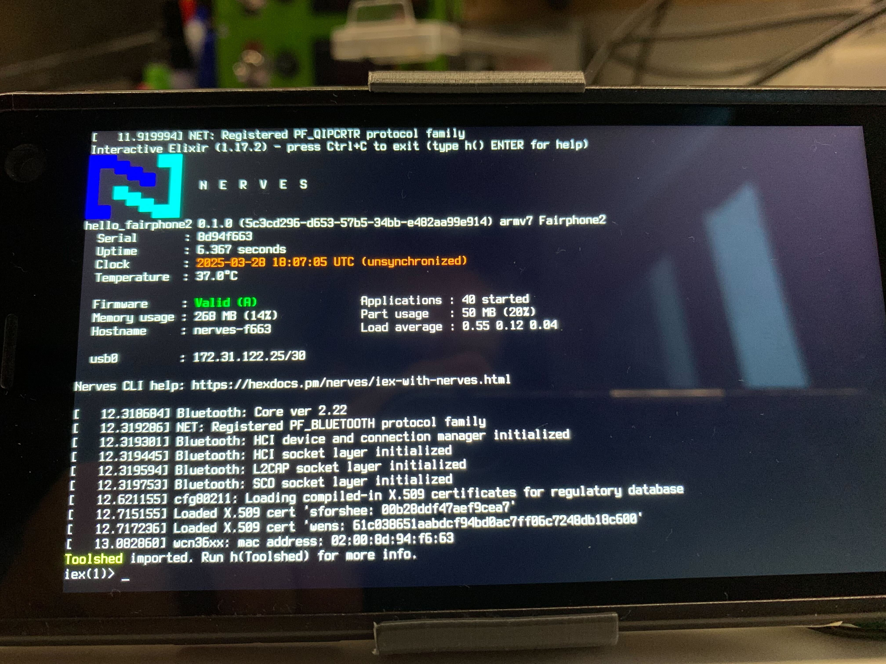

# Fairphone 2

This is the base Nerves System configuration for the Fairphone 2
(Qualcomm Snapdragon 801 / MSM8974, armv7).



| Feature              | Description                                                       |
| -------------------- | ----------------------------------------------------------------- |
| CPU                  | 4x2.26 GHz Qualcomm Snapdragon 801 (Krait, armv7)                 |
| GPU                  | Qualcomm Adreno 330                                              |
| Memory               | 2 GB LPDDR3 RAM                                                   |
| Storage              | eMMC, firmware lives on the Android `userdata` partition          |
| Linux kernel         | [`mlainez/linux-msm8x74`](https://github.com/mlainez/linux-msm8x74), branch `6.12/release` (6.12) |
| Bootloader           | U-Boot → `boot.scr` on the boot subpartition (lk2nd → `extlinux.conf` also works) |
| IEx terminal         | On-device display (`tty1`) or serial debug port (`ttyMSM0`)       |
| Display              | 5" IPS LCD 1080x1920                                             |
| WiFi                 | wcn36xx / prima (firmware + driver via remoteproc)                |
| Bluetooth            | wcn36xx BT (BlueZ userspace) [See Bluetooth](#bluetooth)          |
| Sensors              | ADSP sensor stack (accel/gyro/mag/prox/light) [See Sensors](#sensors) |
| Modem                | 2G/3G/LTE dual SIM via QMI + `vintage_net_qmi` [See Modem](#modem) |
| Camera / Audio       | Present, not yet wired up                                         |

## What changed vs. the older system

- **Kernel** now points at the [`mlainez/linux-msm8x74`](https://github.com/mlainez/linux-msm8x74)
  `6.12/release` branch, the production series, which adds the MSM8974
  ADSP sensor stack and Krait DVFS on top of the msm8974-mainline tree.
  Krait DVFS and CPU thermal throttling are enabled.
- **Bootloader** is U-Boot, which boots `boot.scr` from the active boot
  subpartition. The `extlinux.conf` is still installed, so lk2nd keeps
  working. See [Boot flow](#boot-flow).
- Both device trees are built: the phone (`qcom-msm8974pro-fairphone-fp2.dtb`)
  and the mainboard on a carrier without battery or panel
  (`qcom-msm8974pro-fairphone-fp2-rig.dtb`).
- **Initramfs** is now built from source and matched to the running
  kernel (the `citronics-initramfs` package) instead of downloading a
  single prebuilt `.cpio.gz` with modules baked in for one fixed kernel.
  See [Partition layout](#partition-layout).
- **Sensors** are supported through the ADSP (see [Sensors](#sensors)).
- Built against `nerves_system_br 1.35.3` (Buildroot 2026.08.1,
  Erlang/OTP 29) with the 15.3.1 (GCC 15) armv7 Nerves toolchain.

## Using

In your Nerves application's `mix.exs`:

```elixir
defp deps do
  [
    {:nerves_system_fairphone2,
      git: "https://github.com/Spin42/nerves_system_fairphone2",
      runtime: false, targets: :nerves_system_fairphone2,
      nerves: [compile: true]},

    # Cellular networking — the modem is driven entirely from Elixir.
    {:qmi,             github: "mlainez/qmi",             targets: :nerves_system_fairphone2},
    {:vintage_net_qmi, github: "mlainez/vintage_net_qmi", targets: :nerves_system_fairphone2},

    # Native daemons, one small OTP app each (same apps the FP3 system uses).
    # These start the binaries this system ships (rmtfs / tqftpserv /
    # hexagonrpcd) and bring up the ADSP + modem remoteprocs.
    {:ex_rmtfs,       github: "mlainez/ex_rmtfs",       targets: :nerves_system_fairphone2},
    {:ex_tqftpserv,   github: "mlainez/ex_tqftpserv",   targets: :nerves_system_fairphone2},
    {:ex_hexagonrpcd, github: "mlainez/ex_hexagonrpcd", targets: :nerves_system_fairphone2},
    {:ex_hexagonfs,   github: "mlainez/ex_hexagonfs",   targets: :nerves_system_fairphone2}
  ]
end

def application do
  [
    extra_applications: [
      :logger,
      :ex_hexagonfs,
      :ex_rmtfs,
      :ex_tqftpserv,
      :ex_hexagonrpcd
    ],
    mod: {MyApp.Application, []}
  ]
end
```

Set `MIX_TARGET=nerves_system_fairphone2` and you're off. See the
[Getting started guide](https://hexdocs.pm/nerves/getting-started.html#creating-a-new-nerves-app)
for more on creating a Nerves app, and
[Making custom systems](https://hexdocs.pm/nerves/customizing-systems.html)
if you want to fork and tweak this system.

The `ex_*` OTP apps each own one slice of the Qualcomm bring-up and
log a warning on bad hardware instead of crashing. This replaces the
`/etc/init.d/Sxx` scripts the buildroot reference port used — the
userspace bring-up now lives in supervised OTP applications.

## Flashing your firmware for the first time

Use `mix firmware.image` to generate a `.img` of your firmware.

The stock Fairphone 2 bootloader won't chain-load a foreign kernel, so
first flash U-Boot (a second-stage bootloader) over `boot`, then push
your Nerves firmware into `userdata`. Build `u-boot-fp2.img` with the
`fairphone2_uboot_defconfig` of
[`Spin42/buildroot-android`](https://github.com/Spin42/buildroot-android)
(see its `docs/fairphone2_uboot.md`).

```bash
# Boot the FP2 into fastboot (hold Power + Volume Down). You should land
# on the Fairphone splashscreen with a blue blinking LED; USB-attach it.

fastboot flashing unlock                       # once per device
fastboot -s <serial> flash userdata <your_firmware>.img
fastboot -s <serial> flash boot u-boot-fp2.img # second-stage bootloader
fastboot -s <serial> reboot
```

`lk2nd-msm8974.img` from the
[lk2nd releases](https://github.com/msm8916-mainline/lk2nd/releases)
still boots the same firmware through `extlinux.conf`, without the
U-Boot settings below.

### Citronics Lime and other carrier boards

On the Citronics Lime the mainboard has no panel, so U-Boot boots the
carrier device tree (`qcom-msm8974pro-fairphone-fp2-rig.dtb`) on its own,
and the carrier grounds the USB ID line, so Linux is the USB host of the
carrier's hub (Ethernet, the STM32) and powers it through the PMIC OTG
boost. Nothing has to be set in U-Boot.

Two U-Boot variables override this when needed (`setenv ...; saveenv` at
the U-Boot prompt): `fp2_dtb` names the device tree to boot, and
`usb_mode=host` makes Linux a USB host on a carrier that leaves the ID
line floating.

If nothing failed you should see your phone boot the Nerves firmware.
After that, `mix firmware && mix upload` works over the network, unless
your firmware breaks USB network connectivity.

## Building the system

The Nerves system is consumed like any other — by a Nerves application
that targets it. To build this checkout directly:

```bash
export MIX_TARGET=nerves_system_fairphone2
mix deps.get
mix compile          # runs Buildroot; first build is 30–60 min
```

Useful side-channels:

- `mix nerves.system.shell` — drop into the Buildroot tree with the
  environment set, to run `make menuconfig`, `make linux-menuconfig`, etc.
- `MIX_DEBUG=1 mix compile` — see every Buildroot command.
- `rm -rf _build/*_nerves_system_fairphone2* && mix deps.compile
  nerves_system_fairphone2 --force` — rebuild just the system after a
  defconfig tweak.

The kernel is pinned to a commit of `6.12/release` in `nerves_defconfig`
(`BR2_LINUX_KERNEL_CUSTOM_REPO_VERSION`); bump that SHA to pick up newer
kernel work.

## Partition layout

The Fairphone 2 bootloader won't let us reshape the eMMC partition
table, so the entire Nerves layout is *nested* inside the Android
`userdata` partition (`/dev/mmcblk0p20`). The **citronics initramfs**
runs `kpartx -asf /dev/mmcblk0p20` very early during boot, exposing the
subpartitions as `/dev/mmcblk0p20p1` … `/dev/mmcblk0p20p3`.

```
/dev/mmcblk0p20   ─── flashed via `fastboot flash userdata <fw>.img` ───
├─ MBR (block 0)
├─ uboot env       (Nerves firmware metadata, 8 KiB)
├─ Boot A          (ext2, 50 MiB — kernel + dtbs + initramfs + boot.scr + extlinux)
├─ Boot B          (ext2, 50 MiB)
├─ Rootfs A        (250 MiB)
├─ Rootfs B        (250 MiB)
└─ Application     (f2fs, expands to fill the partition, mounted at /root)
```

### Boot flow

U-Boot maps `userdata` as a block device (`blkmap`) and sources
`/boot.scr` from the first partition of the image in it, which the MBR
swap done by fwup on every update keeps pointing at the active boot
subpartition (`uboot/boot.cmd`). It loads `zImage`, the device tree
(`fp2_dtb`, else the carrier one when LK lit no panel, else the phone
one) and
`initramfs.gz`. lk2nd-msm8974 reads `/extlinux/extlinux.conf` from the
same subpartition instead. The kernel command line passes `rootfs=` / `bootpart=`
to the initramfs, which kpartx-maps the parent device, mounts the
rootfs subpartition read-only at `/sysroot`, mounts the boot
subpartition at `/sysroot/boot`, and `switch_root`s into it. `erlinit`
then mounts `/dev/mmcblk0p20p1` → `/boot` (ro) and `/dev/mmcblk0p20p3`
→ `/root` (f2fs app data).

### Why the initramfs is now built from source

The old `citros-initramfs` package downloaded one prebuilt
`initramfs-citros-<tag>.cpio.gz` with a `/lib/modules/<ver>` tree baked
in for a single kernel build. Every time the kernel moved, the baked-in
modules no longer matched and module loading broke.

The `citronics-initramfs` package builds the initramfs at Buildroot
time instead: it detects the kernel version from the freshly-built
modules tree, copies the few non-busybox helpers it needs (`kpartx`,
`parted`, `unudhcpd`) together with their shared-library closure, and
bakes in the Adreno GPU firmware. Everything boot-critical
(squashfs/ext4/f2fs, device-mapper, USB gadget) is built into the
kernel (`=y`), so the initramfs carries no kernel modules of its own —
see `packages/citronics-initramfs/modules`. The two small init patches
(`mount … -o ro`, and `mount --move /proc /sys /dev` before
`switch_root`) live next to the package and in `patches/`.

## Modem

The modem is driven **entirely from Elixir** through the
[`qmi`](https://github.com/mlainez/qmi) and
[`vintage_net_qmi`](https://github.com/mlainez/vintage_net_qmi) forks —
the same stack the Fairphone 3 system uses. There is no ModemManager.

Bring-up order on this board:

1. The integrated MSM8974 modem (MSS) is a remoteproc whose firmware
   lives in `/lib/firmware` (shipped by the `fp2-firmware` package). It
   needs `rmtfs` (backs the modem's EFS over QRTR) and `tqftpserv`
   (serves firmware files over QRTR) running before it boots. Those are
   the `ex_rmtfs` / `ex_tqftpserv` OTP apps; the system ships the
   `rmtfs` and `tqftpserv` binaries plus the QRTR userspace (`qrtr`).
2. The modem remoteproc is then started (write `start` to
   `/sys/class/remoteproc/<mss>/state`) — handled by your bring-up OTP
   app, or by the kernel if `auto_boot` is left on for the MSS.
3. Once the modem exposes its QMI control channel, `vintage_net_qmi`
   handles UIM provisioning, the data session and DHCP:

```elixir
# config/target.exs
config :vintage_net,
  config: [
    {"wwan0", %{type: VintageNetQMI, vintage_net_qmi: %{service_providers: [%{apn: "internet"}]}}}
  ]
```

```elixir
# or at runtime
VintageNetQMI.quick_configure("internet")
```

`iptables` (`BR2_PACKAGE_IPTABLES`) and `libmnl` are built in for
VintageNet's NAT/route management; `libqmi` is built in for the `qmicli`
debugging CLI.

## Sensors

The Fairphone 2's sensors (LSM330D accelerometer + gyroscope, AK8963
magnetometer, LT1PA01 proximity + ambient light) hang off the **ADSP**,
not the application CPU. The ADSP runs Qualcomm's sensor firmware and
publishes samples over the **SMGR / QMI** service. The `mlainez/linux-msm8x74`
kernel fork adds the in-kernel drivers that consume it:

- `qcom_smgr` (`CONFIG_IIO_QCOM_SMGR*=m`) — surfaces each sensor as a
  `qcom-smgr-*` IIO device under `/sys/bus/iio/devices`.
- `qcom_sns_reg` (`CONFIG_QCOM_SNS_REG=m`) — serves the sensor registry
  `/lib/firmware/qcom/sensors/sns.reg` (shipped by `fp2-firmware`) to
  the ADSP firmware over QMI.
- `qcom_pd_mapper` + `qcom_sysmon` (`=y`) — protection-domain mapping
  and crash monitoring for the ADSP.
- `fastrpc` (`CONFIG_FASTRPC=m`) — provides `/dev/fastrpc-adsp`, which
  `hexagonrpcd` attaches to in order to serve the DSP shell + libraries
  to the ADSP at boot.

So the bring-up chain is: `rmtfs` + `tqftpserv` + `hexagonrpcd` up →
ADSP remoteproc started (`echo start > /sys/class/remoteproc/<adsp>/state`)
→ ADSP loads its sensor firmware → `qcom_smgr` IIO devices appear. The
`ex_rmtfs` / `ex_tqftpserv` / `ex_hexagonrpcd` OTP apps run the daemons;
your application starts the ADSP (an `ex_adsp_boot`-style OTP app, or
leave the kernel's `auto_boot` on).

Once up, read the sensors straight from Elixir:

```elixir
iio = "/sys/bus/iio/devices"

File.ls!(iio)
|> Enum.filter(&String.starts_with?(&1, "iio:device"))
|> Enum.map(fn dev ->
  {File.read!(Path.join([iio, dev, "name"])) |> String.trim(), dev}
end)
# => [{"qcom-smgr-accel", "iio:device0"}, {"qcom-smgr-gyro", ...}, ...]
```

Each device exposes the usual IIO interface — `in_accel_*_raw` /
`in_accel_scale` for one-shot reads, or the buffered `scan_elements` +
character-device path for streaming.

> The ADSP sensor drivers are only present in the
> `mlainez/linux-msm8x74` fork. The `request_firmware` path
> needs `/lib/firmware/qcom/sensors/sns.reg`; the blob committed in
> `packages/fp2-firmware/sns.reg` was extracted from the FP2 persist
> partition.

## WiFi

The base image includes firmware and drivers for the onboard wcn36xx
WiFi device. Configure it with `wpa_supplicant` + VintageNet as usual.

## Bluetooth

Bluetooth is supported through the BlueZ stack. This requires starting
dbus + bluetoothd from an Elixir application; more Elixir testing is
needed.

## UART

A UART port is available (`ttyMSM0`) but requires disassembling the
phone and soldering wires to the motherboard. See this
[discussion thread](https://forum.fairphone.com/t/information-about-the-debug-connector-on-the-fp2/23746/2).
To put the IEx prompt there instead of the display, swap the `-c` line
in `rootfs_overlay/etc/erlinit.config`.
